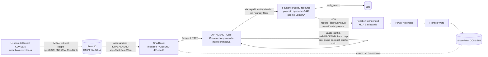

# Paquete de revisión senior · pre-develop

Documentos relacionados:

- [Descripción del PR](pre-develop-pr-description.md)
- [Matriz de pruebas](pre-develop-test-matrix.md)
- [Rollback](pre-develop-rollback-plan.md)
- [Preview de infraestructura](pre-develop-infrastructure-preview.md)
- [RBAC](pre-develop-rbac-plan.md)

## 1. Diagrama: SPA → API → Foundry → MCP → SharePoint

## 2. Modelo de audiencia, scopes y flujo de tokens

| # | Pregunta | Respuesta (código en `pre-develop`) |
|---|---|---|
| 1 | Scope en `authConfig.ts` | `apiScope = api://${VITE_ENTRA_BACKEND_CLIENT_ID}/Chat.ReadWrite`. Sin fallback; si falta o coincide con el frontend, se lanza un error |
| 2 | `loginRequest` | `scopes: [apiScope]` |
| 3 | `tokenRequest` | `scopes: [apiScope]` |
| 4 | `useAuth` | `acquireTokenSilent({...tokenRequest, account})`; si hace falta interacción, `acquireTokenRedirect` |
| 5 | Audiencia del token enviado | Client ID del backend (tokens v2: `requestedAccessTokenVersion: 2` en el registro del backend) |
| 6 | Audiencia que acepta JwtBearer | Solo `{ENTRA_BACKEND_CLIENT_ID}` y `api://{ENTRA_BACKEND_CLIENT_ID}`. El Client ID del SPA da 401 (probado) |
| 7 | Uso real de OBO | **No.** `ENABLE_OBO=false`. El código OBO (credencial federada, sin secreto) queda preparado y se activa solo con `ENABLE_OBO=true` |
| 8 | Credencial hacia Foundry | `ManagedIdentityCredential` (user-assigned `5e283a81…`), con cliente singleton |
| 9 | Delegado frente a managed identity | El token del usuario solo autoriza la llamada **a la API**. La API llama a Foundry **con su identidad**, así que los usuarios no necesitan RBAC sobre Foundry y el aislamiento lo aplica la API (dueño = `oid`). Con OBO, Foundry vería al usuario, pero cada usuario necesitaría un rol de Foundry y habría que dar consentimiento de administrador a Azure ML |

**`VITE_ENTRA_BACKEND_CLIENT_ID` en el build:**

1. Bicep produce `ENTRA_BACKEND_CLIENT_ID`, que azd guarda en `.azure/<env>/.env`.
2. `predeploy.ps1` lo lee (`Get-AzdValue`) y lo pasa como `--build-arg ENTRA_BACKEND_CLIENT_ID` a `docker build` o `az acr build`.
3. `web.Dockerfile` hace `ENV VITE_ENTRA_BACKEND_CLIENT_ID=$ENTRA_BACKEND_CLIENT_ID`.
4. Vite lo incrusta en el bundle (`import.meta.env`) y `buildInfo.ts` escribe `leitneria-build.json`.

**Si cambia sin reconstruir la imagen:**

- `predeploy` compara el `ENTRA_BACKEND_CLIENT_ID` del Container App con el usado en el build y aborta si difieren.
- Si aun así se despliega (por ejemplo, un `az containerapp update` manual), `SpaBundleConsistencyCheck` detiene la API al arrancar. La revisión nunca queda sana y la anterior sigue sirviendo el tráfico.

## 3. Matriz de endpoints y políticas

Política única `RequireChatScope`, aplicada al grupo `/api` y como `FallbackPolicy`:

- token válido: issuer y `tid` del tenant, aud = backend, firma, expiración;
- scope `Chat.ReadWrite`, comparado palabra a palabra;
- `TenantMemberRequirement`;
- `AllowedGroupRequirement` (solo si `ENTRA_ALLOWED_GROUP_ID` tiene valor).

| Endpoint | Acceso |
|---|---|
| `POST /api/chat/stream` | `RequireChatScope` + propietario de la conversación (404) |
| `GET /api/agent` | `RequireChatScope`; sin instrucciones ni metadata |
| `GET /api/conversations` | `RequireChatScope`; filtrado por `oid` |
| `GET /api/conversations/{id}/messages` | `RequireChatScope` + propietario (404) |
| `/api/{**path}` | FallbackPolicy (401 sin token, 404 con token) |
| `/api/health`, `/health`, `/alive` | Anónimos (sondas); solo devuelven el estado |
| Archivos estáticos y fallback del SPA | Anónimos (página de inicio de sesión); `leitneria-build.json` solo contiene IDs públicos |

No hay endpoints de archivos ni de borrado. No existe una política más débil: la prueba `EveryApiEndpoint_UsesTheCorporatePolicy_AndOnlyProbesAndSpaAreAnonymous` falla si aparece una.

## 4. Inventario de variables de entorno

| Variable | Dónde | Obligatoria | Validación |
|---|---|---|---|
| `ENTRA_TENANT_ID` | API, build | Sí | GUID (`ValidateOnStart`) |
| `ENTRA_FRONTEND_CLIENT_ID` | API, build | Sí | GUID |
| `ENTRA_BACKEND_CLIENT_ID` | API, build | Sí | GUID ≠ frontend |
| `ENTRA_SPA_CLIENT_ID` | — | Prohibida | Su presencia impide arrancar |
| `ENTRA_ALLOWED_GROUP_ID` | API, Bicep | No (vacía en dev) | Vacía o GUID canónico (API y `preprovision`) |
| `ENTRA_ALLOW_LOCALHOST_REDIRECTS` | Bicep, hooks | No | `true`/`false`/vacío (`preprovision`, `postprovision`, tipo `bool` de Bicep) |
| `ENTRA_GRANT_SPA_ADMIN_CONSENT` | Bicep | No | ídem |
| `ENABLE_OBO` | API, Bicep, hooks | No | `true`/`false`/vacío (API y `preprovision`) |
| `MANAGED_IDENTITY_CLIENT_ID` | API | En Azure | Obligatoria con OBO |
| `AI_AGENT_ENDPOINT` / `AI_AGENT_ID` / `AI_AGENT_VERSION` | API | Sí / Sí / No | https sin placeholder |
| `APPLICATIONINSIGHTS_*_CONNECTION_STRING` | API (secretRef), build | No | Clave de ingesta (no es credencial de lectura) |
| `TAG_AGENTE` / `TAG_ENTORNO` / `TAG_PLATAFORMA` | Bicep | No | Valores por defecto actuales |

## 5. STRIDE

| Amenaza | Vector | Control actual | Residual |
|---|---|---|---|
| **S**poofing | Token de otro tenant o emitido para otra app | Issuer y `tid` fijados al tenant; aud = backend; firma; exp (probado) | Invitados del tenant son válidos (decisión aceptada) |
| **S**poofing | Uso de un token del SPA contra la API | Registros separados; aud del SPA → 401 | Scope heredado activo durante el rollback (la API nueva lo rechaza igualmente) |
| **T**ampering | Imagen construida para otro backend | `predeploy` + `SpaBundleConsistencyCheck` | Despliegues fuera de azd solo los cubre la comprobación de arranque |
| **T**ampering | Adjuntos manipulados | Firma binaria, UTF-8 estricto, límites, tamaño del cuerpo | Prompt injection vía documentos o web (mitigado en la UI con `SafeMarkdown`) |
| **R**epudiation | Acciones sin traza | Logs de App Insights con correlación; accesos denegados como `Warning` | Sin auditoría por usuario (`oid` con hash) en los logs |
| **I**nformation disclosure | IDOR entre usuarios | Dueño = `oid`, 404 indistinguible (probado) | Conversaciones previas sin dueño, invisibles |
| **I**nformation disclosure | System prompt o secretos en el cliente | `/api/agent` filtrado; escaneo del bundle con canarios (0 hallazgos); sin source maps | Canarios en CI solo si se configura el secreto `SYSTEM_PROMPT_CANARIES` |
| **I**nformation disclosure | Detalles en 401/403 | ProblemDetails genéricos, sin `error_description` | — |
| **D**enial of service | Abuso de tokens del modelo | Rate limiting por usuario, límite de cuerpo y de mensaje | Escalado máximo de 3 réplicas; sin WAF |
| **E**levation of privilege | Endpoint sin protección | `FallbackPolicy` + prueba de matriz | — |
| **E**levation of privilege | RBAC excesivo de la managed identity | Propuesta: solo Foundry User (sección RBAC) | Los 3 roles anteriores siguen hasta validar |
| **E**levation of privilege | Servidor MCP abierto | — (fuera de alcance) | **Alto**: ver riesgo 9.3 |

Ningún hallazgo de STRIDE se implementó fuera del alcance acordado.

## 6. Evidencia: system prompt y secretos

| Comprobación | Resultado |
|---|---|
| Canarios: 12 fragmentos de 60 caracteres de las instrucciones del agente (19 378 caracteres), leídas en solo lectura a un archivo temporal y nunca impresas | 0 apariciones en `frontend/dist` (13 archivos) |
| Control positivo del escáner (canario y clave inyectados) | Detectados (exit 1) |
| Source maps en `dist` | 0 |
| Patrones de secretos (storage key, SAS, clave privada, client secret, JWT, `sk-`, `api-key`, Base64 largo) en `dist` | 0 |
| Los mismos patrones, más `InstrumentationKey=` y `password=`, en 170 archivos de `frontend/src`, `backend`, `deployment`, `infra`, `.github`, `docs` | 0 |
| Contexto de build de Docker | Excluye `**/.env*`, `**/*.local`, `**/bin`, `**/obj`, `.azure` y las pruebas (contexto de 195 KiB en ACR) |
| Logs del backend | No incluyen tokens, claims, grupos, contenido de usuario ni el prompt (aviso de *overage* con texto fijo) |
| Variables `VITE_*` | Solo IDs públicos (tenant, frontend, backend) y la clave de ingesta del navegador de App Insights (pública por diseño) |
| `ErrorBoundary` (`console.error`) | **Baja**: muestra el error de render en la consola del propio usuario; no se envía a ningún sitio |

## 7. Riesgo de usuarios Guest

Single-tenant **no excluye invitados**: un invitado B2B recibe un token con el `tid` de CONSEIN y supera todas las validaciones. Por ahora la decisión es permitirlos. El punto de extensión está documentado en `docs/decisiones-arquitectura.md` §6:

- claim opcional `acct` en el access token del **registro de backend**;
- comprobación en `TenantMemberHandler.HandleRequirementAsync`.

## 8. Riesgo del recurso `prueba7-resource`

- **Variables que apuntan a él:**
  - `AI_AGENT_ENDPOINT=https://prueba7-resource.services.ai.azure.com/api/projects/aguerrero-3446`
  - `AI_FOUNDRY_RESOURCE_NAME=prueba7-resource`
  - `AI_FOUNDRY_PROJECT_NAME=aguerrero-3446`
  - El scope RBAC de `postprovision`
- **Riesgos:**
  - Nombre de prueba y proyecto personal.
  - **Compartido** con al menos otros 2 service principals.
  - Autenticación local (claves) habilitada y red pública `Allow`.
  - Existe otro recurso, `prj-leitner-ia-dev-resource`, sin uso.
- **Backlog** (no se hace en esta fase): crear el recurso de Foundry definitivo de LeitnerIA, migrar el agente y la conexión MCP, y repetir la asignación de "Foundry User".

## 9. Riesgo de `leitnermcp3` sin endurecer

Estado observado (solo lectura), sin cambios en esta fase:

- `httpsOnly=false`.
- Sin App Service Authentication.
- Sin managed identity.
- Storage con clave compartida activa, TLS 1.0 y red `Allow`.
- En el agente, la herramienta MCP tiene `require_approval=never` y escribe en SharePoint mediante Power Automate.

Propuesta en modo prueba: `deployment/scripts/harden-external-resources.ps1`. **Requiere a los responsables del MCP.**

## 10. Dependencias de administrador de Entra

1. Crear el registro de backend y su service principal (si el tenant restringe el registro de apps).
2. Consentimiento SPA → backend, si el tenant bloquea el consentimiento de usuario.
3. Lecturas de las puertas previas: id del scope heredado, existencia del backend y política de consentimiento.
4. Asignar "Foundry User" (Owner o User Access Administrator sobre el proyecto; no es un rol de Entra, pero sí privilegiado).
5. Si OBO se activa en el futuro: consentimiento de administrador del backend hacia Azure ML (`user_impersonation`), que es tenant-wide.

## 11. Checklist de smoke tests y rollback

- Smoke tests: [matriz, sección 3](pre-develop-test-matrix.md#3-smoke-tests-manuales-con-dos-usuarios-reales).
- Rollback: [plan](pre-develop-rollback-plan.md).
